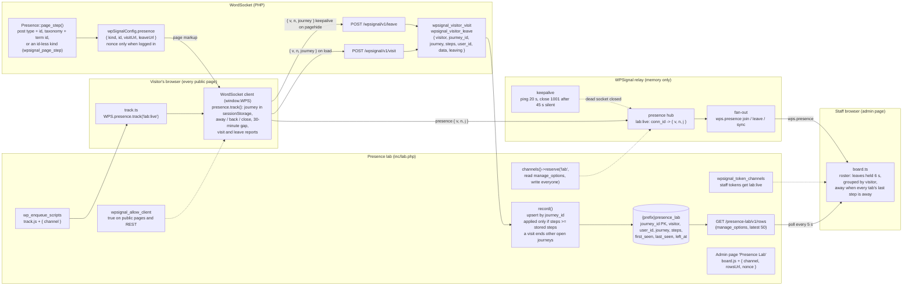

# WordSocket Presence Lab

A reference consumer, not a product. Stage 1 of Phase 60 proved here that WordPress can know a visitor's path and departure with no heartbeat, no scheduled job, and the relay's presence left exactly as it is. Stage 2 moved that into WordSocket 0.30 as `WPS.presence.track()`, and this plugin is what an extension writes on top of it:

- `src/track.ts`: one call, `WPS.presence.track( channel )`.
- `src/board.ts`: an admin page showing the live roster from presence next to what WordPress stored.
- `inc/lab.php`: the `lab` namespace, a listener on `wpsignal_visitor_visit` and `wpsignal_visitor_leave` writing one row per journey, `GET /presence-lab/v1/rows`, the admin page.

The journey format and the storer's rules are in the root `CLAUDE.md` ("Visitor journeys"). Run it on the E2E site against the rehearsal relay: `npm install && npm run build && npm run test:e2e` (settings in `tests/local.json`, same keys as WordSocket's). The eight cases in `tests/e2e/lab.spec.ts` are the tests of WordSocket's tracker.

## How it fits together



```mermaid
sequenceDiagram
  participant V as Visitor's browser (WPS.presence.track)
  participant R as Relay
  participant WP as WordPress (WordSocket routes, lab listener)
  participant B as Staff board

  Note over V: page load, kind:id from wpSignalConfig.presence
  V->>V: journey.step(kind, id)
  V->>R: presence join lab:live { v, n, j: "home:2:0" }
  R->>B: wps.presence join
  V->>WP: POST /wpsignal/v1/visit { v, n, journey }
  WP->>WP: wpsignal_visitor_visit: row upsert (steps 1)

  Note over V: tab hidden
  V->>V: journey.away()
  V->>R: presence update { v, n, j: "home:2:3000>away:0:0" }
  R->>B: wps.presence join (update)
  B->>B: visitor shown Away

  Note over V: tab visible again within the gap
  V->>V: journey.back()
  V->>R: presence update { v, n, j: "...>away:0:22000>home:2:0" }

  Note over V: navigation to the next page
  V->>V: pagehide: journey.close()
  V-->>WP: POST /wpsignal/v1/leave keepalive { v, n, journey } (steps N)
  V--xR: socket closes
  R->>B: wps.presence leave
  B->>B: held 6 s, nothing shown

  Note over V: next page loads within the grace
  V->>R: presence join { v, n, j: "...>post:1:0" }
  R->>B: wps.presence join
  B->>B: same visitor, no flicker
  V->>WP: POST /visit (steps N+1)
  WP->>WP: whichever of leave and visit lands second is applied only if its step count is not lower: left_at ends NULL

  alt tab closed
    V-->>WP: POST /leave keepalive: left_at = now
    V--xR: socket closes
    R->>B: leave, dropped after 6 s
  else browser killed or network gone
    Note over WP: no leave arrives, row stays open
    R->>R: socket gone at once (process killed) or after the 45 s deadline (half-open)
    R->>B: leave, dropped after 6 s
  else back after more than 30 minutes
    V->>V: new journey id, old one ends in away:0:1800000
    V-->>WP: POST /leave for the old journey, POST /visit for the new
    WP->>WP: the visit ends the visitor's other open journeys; a leave never does
  end
```
