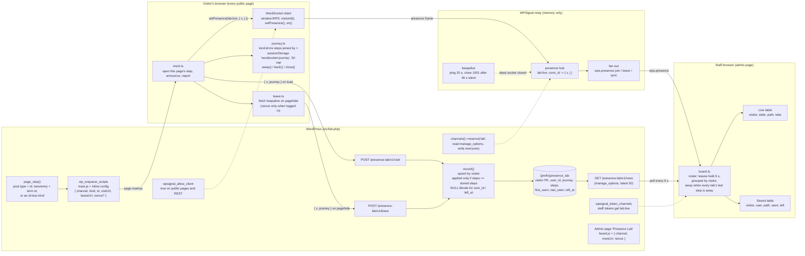
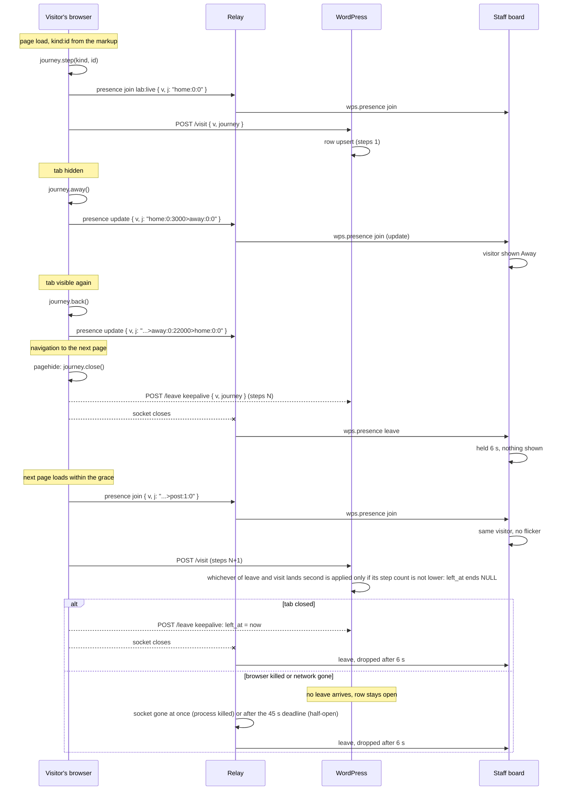

# WordSocket Presence Lab

A proof of concept, not a product: the generic half of ShopSocket's cart history (Phase 60, stage 1). What can WordPress know about a visitor's path and departure with no heartbeat, no scheduled job, and the relay's presence left exactly as it is?

- `src/journey.ts`: the journey string, `kind:id:ms` steps joined by `>`, `away` as a step, kept in `sessionStorage`.
- `src/leave.ts`: the leave report on `pagehide`, `fetch` with `keepalive` so it can carry the nonce.
- `src/track.ts`: presence with `{ v, j }`, the visit report, away and back, back/forward cache.
- `src/board.ts`: an admin page showing the live roster from presence next to what WordPress stored.
- `inc/lab.php`: the `lab` namespace, `POST /presence-lab/v1/visit` and `/leave`, one table, the admin page.

Run it on the E2E site against the rehearsal relay: `npm install && npm run build && npm run test:e2e` (settings in `tests/local.json`, same keys as WordSocket's). The six cases in `tests/e2e/lab.spec.ts` are the exit criteria: when they pass with the three browser files unchanged, the design moves into WordSocket.

## How it fits together

